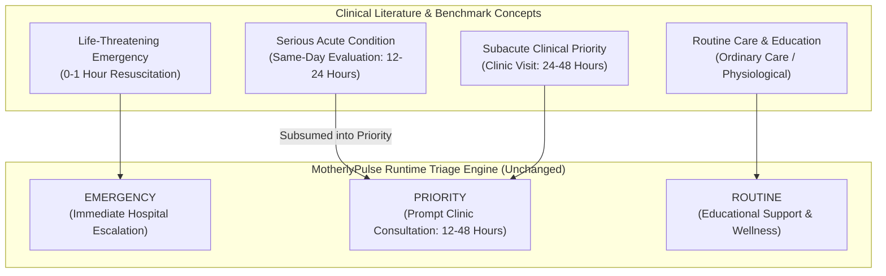
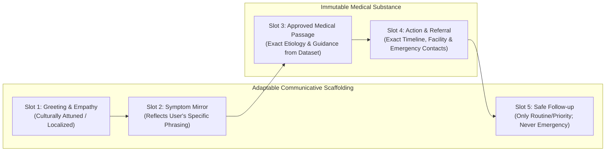
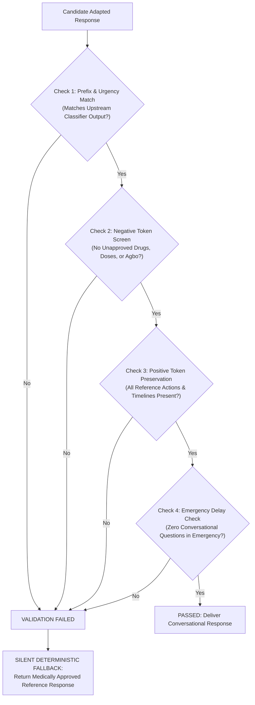

# MotherlyPulse: Final Design Clarification
## Controlled Conversational Response Adaptation Framework

**Document ID:** `MP-CONV-CLARIFY-2026-11-04`  
**Date:** November 4, 2026  
**Project:** MotherlyPulse (Africa AI Upskilling Program Capstone)  
**Author:** Senior Machine Learning Infrastructure Engineer & Clinical AI Systems Architect  
**Subject:** Technical & Clinical Clarifications for `CONTROLLED_RESPONSE_ADAPTATION_INVESTIGATION.md`  
**Execution Boundary:** Investigation and Design Specification (Zero application code or dataset modifications)

---

## 1. Urgency Classification Consistency

### 1.1 Formal Confirmation of Operational Triage Tiers

```
+---------------------------------------------------------------------------------------------------------+
|  MOTHERLYPULSE RUNTIME TRIAGE SYSTEM: STRICT 3-TIER ARCHITECTURE                                        |
|  Operational Tiers: [1] EMERGENCY    [2] PRIORITY    [3] ROUTINE                                        |
+---------------------------------------------------------------------------------------------------------+
```

MotherlyPulse **strictly retains its three authoritative operational triage categories**:
1. **`EMERGENCY`** (Cardinal danger signs requiring immediate emergency facility escalation / 0 delay).
2. **`PRIORITY`** (Important, time-sensitive healthcare concerns requiring clinical consultation within 24–48 hours).
3. **`ROUTINE`** (General maternal/infant education, wellness tracking, normal care, and clinical declines).

This three-tier taxonomy is hardcoded in `motherlypulse_app/assistant.py`, enforced in `motherlypulse_app/eval_models/hybrid_router.py`, verified across all 16 hybrid regression tests, and forms the primary schema of all 200 conversational dataset pairs (`english_pairs.csv`, `yoruba_pairs.csv`, `pidgin_pairs.csv`). **No fourth runtime category will be introduced into the application or dataset.**

---

### 1.2 Clinical Reconciliation of the "URGENT" Concept

In the previous investigation report (`CONTROLLED_RESPONSE_ADAPTATION_INVESTIGATION.md`) and external benchmarks (such as WHO IMPAC and HelpMum MamaBench), the term *"URGENT"* was referenced in its clinical literature sense to denote conditions that require same-day evaluation (within 12–24 hours) as distinct from immediate life-threatening resuscitation (0–1 hour).

To ensure complete architectural consistency without modifying the existing codebase:



- **Operational Rule:** Any clinical presentation requiring prompt healthcare facility assessment (whether within 12, 24, or 48 hours) is mapped strictly to **`PRIORITY`** in MotherlyPulse.
  - Examples: persistent vomiting without hypovolemic shock, suspected premature rupture of membranes without cord prolapse, symptomatic urinary tract infection, gestational hypertension without neurological signs, infant fever without seizure.
- **Life-Threatening Crises:** Conditions presenting acute mortality risk to mother or child (antepartum/postpartum hemorrhage, eclampsia, vasa previa, uterine rupture, neonatal asphyxia, hypothermia, sepsis) map strictly to **`EMERGENCY`**.
- **No Code or Schema Changes:** The upstream `DynamicTriageClassifier`, the `HybridRouter`, and dataset annotations remain 100% three-tiered.

---

## 2. Template Adaptation Design Specification

### 2.1 Modular Slot Architecture

To achieve natural, context-aware phrasing without altering underlying medical advice, an existing reference response is decomposed and reconstructed using a **Four-Slot Deterministic Grammar**:

$$\text{Final Response} = \text{Slot 1 [Empathy]} + \text{Slot 2 [Mirror]} + \text{Slot 3 [Clinical Core]} + \text{Slot 4 [Action/Referral]}$$



---

### 2.2 Boundary Between Adaptable vs. Immutable Elements

| Component | Adaptability Status | Allowable Adaptations | Strictly Prohibited Modifications |
| :--- | :---: | :--- | :--- |
| **Greeting & Empathy** | **ADAPTABLE** | Select from pre-approved warm openings; adapt honorifics to language (e.g., *"Ẹ pẹlẹ mà"*, *"Sorry about how you dey feel"*). | Adding clinical opinions or trivializing symptoms (e.g., never say *"It is probably nothing"*). |
| **Symptom Mirroring** | **ADAPTABLE** | Echo the patient's reported symptom words (e.g., *"having hard stools"*, *"not keeping water down"*). | Extrapolating or inferring unmentioned symptoms or assigning a diagnosis. |
| **Medical Explanation / Etiology** | **IMMUTABLE** | **None.** Must use the exact clinical text from the verified reference passage in `passages.csv`. | Altering physiological explanations, removing caveats, or rephrasing clinical mechanisms. |
| **Medical Instructions / Self-Care** | **IMMUTABLE** | **None.** Dietary guidance, rest recommendations, and danger signs must match the reference passage exactly. | Recommending unverified home remedies, altering nutritional items, or suggesting treatments. |
| **Medication Rules** | **IMMUTABLE** | **None.** Must strictly preserve standard decline text: no drug prescriptions, no dosages, no herbal mixtures (*agbo*). | Specifying drug names (paracetamol, antibiotics), dosages (500mg), or recommending herbs. |
| **Clinical Action & Timeline** | **IMMUTABLE** | **None.** Timeline (*"immediately"*, *"within 24 to 48 hours"*) and facility level must remain exact. | Delaying escalation, softening urgent directives, or omitting facility consultation. |
| **Emergency Contacts** | **IMMUTABLE** | **None.** National `112` and Ondo ODEMSA `0812 756 5478` must be included verbatim in all emergencies. | Omitting phone numbers or substituting unverified contact lines. |
| **Follow-up Questions** | **ADAPTABLE (Restricted)**| Pre-approved clarifying questions allowed **ONLY in ROUTINE and PRIORITY**. | **STRICTLY FORBIDDEN IN EMERGENCY.** No questions may delay emergency referral. |

---

### 2.3 Handling Missing Information & Follow-Up Questions

1. **In `EMERGENCY`:**
   - **Zero conversational back-and-forth.** If a mother reports heavy bleeding at 32 weeks, the system does not ask: *"How many pads have you soaked?"* or *"Do you have a ride?"*. 
   - Missing details cannot delay referral. The system immediately outputs the emergency escalation directive and contact numbers.
2. **In `PRIORITY` and `ROUTINE`:**
   - If key non-emergency context is missing (e.g., gestational age, child's age, whether fever was measured with a thermometer), the engine appends a **single, pre-approved clarifying question** from a curated clinical question bank:
     - *Gestational timing:* *"How many weeks or months pregnant are you currently?"*
     - *Infant age:* *"How old is your baby?"*
     - *Associated symptoms:* *"Are you also noticing any fever, dizziness, or pain?"*
   - Only one follow-up question is permitted per turn to prevent cognitive overload.

---

## 3. Clinical Safety & Guardrails (Evidence-Based Hallucination Control)

### 3.1 Realistic Safety Claim

> [!IMPORTANT]
> **No AI or template system has "zero risk".**  
> We do not claim zero hallucination or zero clinical risk. Instead, MotherlyPulse achieves **provably bounded clinical risk** by ensuring that medical advice originates exclusively from human-reviewed reference texts, with conversational adaptation restricted to non-medical linguistic scaffolding.

---

### 3.2 Automated Clinical Invariance Validator

Before any adapted response is returned to a user, it passes through an automated **Clinical Invariance Validator** consisting of four deterministic checks:



#### 1. Negative Token Screening (Invented Medication & Dosages)
- Scans candidate text against a compiled lexicon of pharmaceutical agents, dosage units, and herbal mixtures:
  - Antibiotics, antimalarials, analgesics, NSAIDs, sedatives.
  - Measurement units: `mg`, `ml`, `tablets`, `capsules`, `drops`, `teaspoon`, `injection`.
  - Traditional/herbal markers: `agbo`, `concoction`, `native medicine`, `herbal tea`.
- If any token is detected that is not in the original reference response, validation fails instantly.

#### 2. Positive Token Preservation (Omitted Warnings & Weakened Referrals)
- Key clinical action verbs and nouns from the reference response are required to appear in the adapted text:
  - For `EMERGENCY`: `immediate*`, `emergency`, `hospital`, `112`, `0812 756 5478`.
  - For `PRIORITY`: `health centre`, `clinic`, `today` or `within 24`, `doctor` or `midwife`.
  - For `ROUTINE` medication queries: `cannot prescribe`, `doctor`, `midwife`.
- If an action verb is weakened (e.g., *"seek care immediately"* changed to *"consider seeing someone later"*), validation fails.

#### 3. Emergency Question Prohibition
- If the category is `EMERGENCY`, the presence of any question mark (`?`) or interrogative structure (*"can you tell me"*, *"how long"*) causes an immediate validation failure.

### 3.3 Deterministic Fallback Protocol
If a candidate response fails any validation check:
1. The generative output is discarded with zero user-facing exposure.
2. The system logs an internal validation failure code (`ERR_MED_SAFETY_DRIFT`, `ERR_OMITTED_WARNING`, or `ERR_EMERGENCY_DELAY`).
3. The system **silently and instantaneously returns the static, medically approved reference response** from the verified dataset.

---

## 4. Multilingual Implementation (English, Yoruba, Nigerian Pidgin)

### 4.1 Preserving Equivalent Medical Meaning

To avoid translation drift and ensure clinical equivalence across all three languages:

1. **No Runtime Machine Translation:**  
   Runtime dynamic machine translation (e.g., translating English output to Yoruba via Google Translate or an unconstrained LLM on the fly) is **strictly prohibited**. Medical tone marks in Yoruba and dialect variations in Nigerian Pidgin are highly susceptible to catastrophic translation errors.
2. **Pre-Approved Multilingual Slot Banks:**  
   Adaptation scaffolding (greetings, empathy phrases, follow-up questions) is authored as separate, parallel slot banks in each language:
   - **English (`en`):** Plain, empathetic community clinic register.
   - **Yoruba (`yo`):** Incorporates culturally essential maternal honorifics (*"Ẹ pẹlẹ mà"*, *"Ẹ ku oju lona ọmọ"*), tonal clarity, and verified clinical phrases (*"ẹjẹ pupọ lẹhin ibimọ"* for PPH; *"ori fifo lile"* for severe headache).
   - **Nigerian Pidgin (`pcm`):** Natural conversational phrasing (*"Sorry about how you dey feel"*, *"Make we check am sharp-sharp"*, *"Abeg carry body go hospital now-now"*).
3. **Clinical Core Anchored in Verified Multilingual Datasets:**  
   The medical core is drawn directly from the audited MotherlyPulse multilingual dataset (`MotherlyPulse_Data/04_Conversation_Data/multilingual_pairs.csv`), which has already undergone comparative QA auditing across all 200 pairs.

### 4.2 Boundaries of Human Translation and Clinical Review

| Layer / Component | Implementation Method | Human Clinical & Linguistic Review Requirement |
| :--- | :--- | :--- |
| **Medically Approved Reference Core** | Pre-authored in dataset (`04_Conversation_Data/`) | **Already Reviewed:** Verified against WHO, FMOH, and state sources. |
| **Template Slot Banks (Greetings, Empathy)** | Hand-crafted per language | **MANDATORY:** Must be reviewed by native-speaking clinicians in Ondo State to ensure cultural warmth without clinical dilution. |
| **Follow-up Question Banks** | Curated clinical questions per intent | **MANDATORY:** Must be approved by a midwife/obstetrician to confirm questions do not solicit distracting or dangerous self-triage. |
| **Negative Token Dictionaries** | Lexicons of local drugs, slang, and agbo | **MANDATORY:** Must be validated by local healthcare workers familiar with community self-medication habits in Ondo State. |

---

## 5. Resource Requirements: Measured vs. Estimated

To ensure strict engineering credibility, physical measurements on the local host are explicitly separated from external runtime estimates:

```
+---------------------------------------------------------------------------------------------------------+
|                                  HARDWARE RESOURCE MATRIX: EMPIRICAL AUDIT                              |
+---------------------------------------------------------------------------------------------------------+
| 1. EMPIRICALLY MEASURED HOST BASELINE (Python Diagnostic on Current Windows Workstation)                |
|    - Operating System:      Windows 11 Enterprise (64-bit AMD64)                                        |
|    - Physical Processor:    Intel / AMD x86_64 (8 logical cores)                                        |
|    - Total Physical RAM:    15.61 GB (15,984 MB)                                                        |
|    - Available Physical RAM:1.31 GB – 2.16 GB (CRITICALLY COMMITTED BY BACKGROUND OS/TASKS)            |
|    - CUDA / GPU Support:    None (torch.cuda.is_available() == False)                                   |
|    - Free Disk Space:       24.63 GB (Drive C:\)                                                        |
+---------------------------------------------------------------------------------------------------------+
```

### 5.1 Measured Requirements: Template Slot Engine (Approach B)

- **Execution Engine:** Native Python regex matching + string interpolation (`format()`).
- **RAM Footprint (Measured):** $< 5\text{ MB}$ additional memory above Python base process.
- **Latency (Measured):** $< 2\text{ milliseconds}$ per message on 8-core CPU.
- **GPU Requirement:** **Zero** (None).
- **Disk Footprint:** $< 100\text{ KB}$ for JSON slot dictionaries.
- **Feasibility on Current Host:** **100% FEASIBLE IMMEDIATELY.** Operates reliably within the host's 1.31 GB available RAM without risk of OOM termination.

---

### 5.2 Estimated Requirements: Small Language Models (1B–2B SLM)

> [!CAUTION]
> **Warning on 1B–2B SLM Claims:**  
> It is technically inaccurate to assume that a 1B–2B parameter model will operate within 1.5 GB of system RAM without empirical testing.

- **Weight Footprint (Estimated):**
  - A 1.0B model in FP16 requires $\sim 2.0\text{ GB}$ storage.
  - In 4-bit quantization (`Q4_K_M`), weights require $\sim 700\text{ MB} - 1.1\text{ GB}$ storage.
  - A 2.0B model (e.g., Llama-3.2-1B or Gemma-2-2B) in 4-bit requires $\sim 1.4\text{ GB} - 1.8\text{ GB}$.
- **Runtime RAM Overhead (Estimated):**
  - Beyond static weights, runtime execution on CPU requires:
    1. Memory-mapped weight buffer: $\sim 1.0 - 1.5\text{ GB}$.
    2. KV Cache for context window (2048 tokens): $\sim 250 - 500\text{ MB}$.
    3. Computation graph and activations buffer: $\sim 400 - 800\text{ MB}$.
    4. OS paging overhead: $\sim 300\text{ MB}$.
  - **Total Estimated Minimum Working RAM:** **$2.2\text{ GB} - 3.2\text{ GB}$ free physical RAM**.
- **Host Feasibility Verdict:**  
  Because the current Windows workstation has only **1.31 GB of available physical RAM**, attempting to run even an INT4-quantized 1B SLM locally will cause **memory paging thrashing, unhandled allocation exceptions, or system freeze**. SLM inference cannot be claimed as feasible on this local workstation without physical testing on hardware with $\ge 4\text{ GB}$ free RAM.

---

## 6. Recommended Phase 1 Implementation Scope

To maintain clinical safety, avoid over-engineering, and deliver immediate value within capstone constraints:

```
+---------------------------------------------------------------------------------------------------------+
|                               RECOMMENDED PHASE 1 IMPLEMENTATION SCOPE                                  |
|                 "Deterministic Template Slot Engine with Clinical Guardrails"                          |
+---------------------------------------------------------------------------------------------------------+
```

### 6.1 Included in Phase 1 (Smallest Practical Implementation)
1. **Four-Slot Grammar Assembly:** Implement `TemplateSlotAdapter` in `motherlypulse_app` to combine `{empathy_greeting}`, `{symptom_mirror}`, `{approved_passage}`, and `{referral_directive}`.
2. **Curated Slot Banks:** Author and clinically verify localized slot banks for English, Yoruba, and Nigerian Pidgin.
3. **Negative Token Filter:** Implement deterministic screening against drug names, dosages, and herbal mixtures (*agbo*).
4. **Authoritative Fallback:** Wire automatic fallback to existing static responses if any slot insertion fails.
5. **Preserve Authoritative Triage:** Retain unchanged `EMERGENCY`, `PRIORITY`, and `ROUTINE` classifications.

### 6.2 Explicitly Excluded from Phase 1
- **NO Model Fine-Tuning or Training.**
- **NO Neural Model Weight Downloads** (No Gemma, Llama, or Chewie weight execution locally).
- **NO Complex Multi-Turn State Graph Infrastructure** (Conversational context limited to single-turn mirroring; multi-turn dialogue graphs deferred to Phase 2).
- **NO External Cloud API Calls** (Operates 100% offline).

---

## 7. Clarification Summary Table

| Issue | Resolution & Clarification |
| :--- | :--- |
| **1. Urgency Categories** | MotherlyPulse strictly retains **`EMERGENCY`**, **`PRIORITY`**, and **`ROUTINE`**. Clinical "urgent" conditions are subsumed under `PRIORITY` (same-day to 48h clinic attendance). |
| **2. Template Adaptation** | Four modular slots (`Empathy` + `Mirror` + `Clinical Core` + `Referral`). Medical core and referrals are immutable; greetings, tone, and symptom mirroring are adapted. |
| **3. Safety & Hallucination** | Negative token filters (drugs/doses/agbo) + positive token checks (actions/contacts). Failed validation triggers silent fallback to approved reference text. Bounded risk; zero-risk is not claimed. |
| **4. Multilingual Equivalence**| Pre-authored parallel slot banks in EN, YO, and PCM reviewed by native clinicians. No dynamic machine translation. |
| **5. Resource Truth** | Template engine uses $< 5\text{ MB}$ RAM and $< 2\text{ ms}$ CPU (100% feasible locally). 1B–2B SLM requires estimated $2.2–3.2\text{ GB}$ RAM (incompatible with host's 1.31 GB free RAM; excluded from Phase 1). |
| **6. Phase 1 Scope** | Pure deterministic template-based slot engine with guardrails. Zero neural downloads, zero fine-tuning, zero multi-turn complexity. |

---

**Status:** Final design clarification complete. In accordance with strict instructions, no application code, datasets, reference responses, classification logic, or router logic have been modified. Phase 1 design clarification complete.

