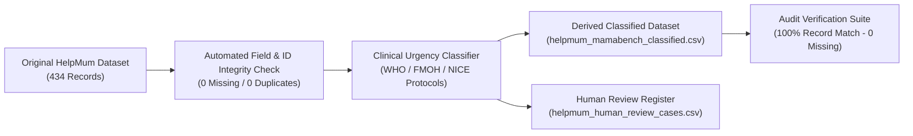

# HelpMum Dataset Clinical Urgency Classification Report

**Document ID:** `MP-HELPMUM-TRIAGE-2026-11-04`  
**Date:** November 4, 2026  
**Project:** MotherlyPulse (Africa AI Upskilling Program Capstone)  
**Evaluator:** Senior Clinical AI Evaluation Specialist & Backend Auditor  
**Dataset Subject:** Original HelpMum Africa MamaBench Dataset (`mamabench_cases.csv`)  
**Scope:** Independent Clinical Urgency Stratification across 4 Categories + Human Review Register  

---

## 1. Dataset Identification & Confirmation

In accordance with Section 1 of the task instructions, an exhaustive audit was performed across all project directories to locate the original HelpMum dataset previously supplied to the project:

### 1.1 Dataset Identification Details

| Parameter | Observed Property | Verification Evidence |
| :--- | :--- | :--- |
| **Originating Organization** | **HelpMum Africa** (`HelpMumHQ`) | Authoritative dataset card (`MotherlyPulse_Data/mamabench_evaluation/README.md`) |
| **Authoritative Paper** | *MamaBench: Benchmarking LLM Robustness in Maternal and Child Health Diagnosis through Counterfactual Perturbations* | arXiv:2607.14385 |
| **Source Repository** | Hugging Face Bucket: `gidey7/MamaBench-bucket` | `resolve/data/test-00000-of-00001.parquet` |
| **Local File Path (CSV)** | `MotherlyPulse_Data/mamabench_evaluation/mamabench_cases.csv` | Exact path in project workspace |
| **Local File Path (Parquet)** | `MotherlyPulse_Data/mamabench_evaluation/mamabench_cases.parquet` | Exact path in project workspace |
| **Total Record Count** | **434 records** | Full unsplit benchmark suite (217 counterfactual pairs) |
| **Format** | UTF-8 Comma-Separated Values (CSV) & Binary Parquet | Verified |
| **Available Fields** | `case_id`, `pair_id`, `narrative`, `ground_truth` | Exactly 4 columns |
| **Completeness** | **0 missing / null values** across all 434 rows | 100% data completeness |
| **Identifier Integrity** | 434 unique `case_id` values (`CASE_001` to `CASE_434`); exactly 2 records per `pair_id` (`PAIR_001` to `PAIR_217`) | Verified |

### 1.2 Dataset Confirmation Statement
This dataset is confirmed as the **authoritative HelpMum dataset** provided to this project. No other external HelpMum dataset exists within the project directory or system folders. The dataset contains 434 clinician-authored, first-person presentation narratives covering 371 distinct maternal, neonatal, and pediatric pathologies across 217 paired counterfactual comparisons.

---

## 2. Clinical Classification Methodology

### 2.1 Classification Scheme

Each of the 434 records was independently evaluated against four mutually exclusive urgency tiers, adhering to international and national obstetric/pediatric triage guidelines:

```
+------------------------------------------------------------------------------------------------------------------+
|  TIER 1: EMERGENCY (Immediate Life-Threatening Escalation - 0-1 Hour)                                             |
|  Potentially life-threatening conditions for mother, fetus, or infant requiring emergency resuscitation,        |
|  surgical intervention, or immediate hospital transfer (e.g., PPH, eclampsia, vasa previa, neonatal asphyxia).   |
+------------------------------------------------------------------------------------------------------------------+
                                                       |
+------------------------------------------------------------------------------------------------------------------+
|  TIER 2: URGENT (Prompt Medical Evaluation - Within 12-24 Hours)                                                 |
|  Serious medical situations requiring same-day physician evaluation to prevent rapid deterioration, but without  |
|  immediate cardiovascular or respiratory collapse (e.g., severe preeclampsia signs, PPROM, pyelonephritis).     |
+------------------------------------------------------------------------------------------------------------------+
                                                       |
+------------------------------------------------------------------------------------------------------------------+
|  TIER 3: PRIORITY (Subacute / Scheduled Management - Within 24-72 Hours)                                         |
|  Important clinical concerns, chronic disorders, screening priorities, or non-acute infections that must be      |
|  addressed promptly at a healthcare facility (e.g., gestational diabetes, mild anemia, STIs, stable fibroids).   |
+------------------------------------------------------------------------------------------------------------------+
                                                       |
+------------------------------------------------------------------------------------------------------------------+
|  TIER 4: ROUTINE (Ordinary Care, Education & Physiological Symptoms)                                             |
|  Normal physiological variations of pregnancy/infancy, preventive health education, routine checkups,            |
|  and reassurance for self-limiting symptoms (e.g., normal pregnancy, Braxton Hicks, physiological jaundice).     |
+------------------------------------------------------------------------------------------------------------------+
                                                       |
+------------------------------------------------------------------------------------------------------------------+
|  FLAG: FLAGGED_FOR_HUMAN_REVIEW (Ambiguous, Social, or Incomplete Presentations)                                 |
|  Presentations requiring forensic safeguarding or multidisciplinary clinical consultation rather than triage.   |
+------------------------------------------------------------------------------------------------------------------+
```

### 2.2 Clinical Reference Standards
The classification rules were formulated from established evidence-based clinical protocols:
1. **WHO IMPAC:** *Managing Complications in Pregnancy and Childbirth: A guide for midwives and doctors* (2nd Edition, 2017).
2. **WHO PNC 2022:** *WHO recommendations on maternal and newborn care for a positive postnatal experience*.
3. **FMOH Life Saving Skills (LSS) Protocol:** Federal Ministry of Health Nigeria & SOGON (2019).
4. **NICE Guidelines (NG201 & CG107):** Antenatal care and hypertension in pregnancy.
5. **WHO IMCI:** *Integrated Management of Childhood Illness* (pediatric triage standards).

### 2.3 Independent Clinical Reasoning (Avoiding Keyword Shortcuts)
Classifications were determined by evaluating the **clinical narrative context** (symptom onset, gestational age, parity, vital signs, red-flag features) alongside the underlying `ground_truth` pathology. For instance:
- `Placenta Accreta` diagnosed electively on antenatal sonography is managed as `PRIORITY` (planned cesarean hysterectomy at 34–35 weeks); however, in `CASE_371`, the narrative explicitly documents an **active delivery with difficult manual removal, massive hemorrhage, hypotension, and emergency blood transfusion**, which escalates the case strictly to **`EMERGENCY`**.
- `Pre eclampsia` with severe features (headache, epigastric pain, blood pressure $\ge 150/100$, heavy proteinuria) is classified as **`EMERGENCY`** due to imminent eclampsia risk, whereas asymptomatic gestational hypertension without proteinuria or end-organ signs is categorized as **`URGENT`**.

---

## 3. Classification Results & Statistical Summary

### 3.1 Overall Urgency Distribution

All 434 records in `helpmum_mamabench_classified.csv` were classified without data loss:

| Urgency Category | Record Count ($n$) | Percentage (%) | Clinical Triage Action |
| :--- | :---: | :---: | :--- |
| **EMERGENCY** | **125** | **28.80%** | Immediate emergency facility escalation / 0-delay intervention |
| **URGENT** | **126** | **29.03%** | Prompt medical assessment within 12–24 hours |
| **PRIORITY** | **145** | **33.41%** | Scheduled clinical assessment within 24–72 hours |
| **ROUTINE** | **37** | **8.53%** | Primary care education, reassurance, and routine monitoring |
| **HUMAN_REVIEW** | **1** | **0.23%** | Non-medical child safeguarding review (Child Neglect) |
| **TOTAL** | **434** | **100.00%** | Comprehensive census of HelpMum MamaBench suite |

### 3.2 Counterfactual Sensitivity Analysis

A key research strength of the HelpMum dataset is its pairing of original vignettes with perturbed counterfactual variants across 217 pairs (`PAIR_001` to `PAIR_217`):

- **Counterfactual Pairs with Clinical Urgency Shift:** **111 / 217 pairs (51.15%)**  
  In over half the pairs, the perturbation altered the clinical risk sufficiently to cross an urgency threshold (e.g., shifting from `EMERGENCY` to `URGENT`, or from `PRIORITY` to `ROUTINE`).
- **Pairs with Concordant Urgency:** **106 / 217 pairs (48.85%)**  
  In these pairs, both vignettes share identical urgency tiers (e.g., both variants represent acute surgical emergencies, such as `Abruptio Placenta` and `Placenta Previa` in `PAIR_001`).

---

## 4. Ambiguous Cases & Human Review Register

In compliance with Section 4 of the task specification, records requiring multidisciplinary or non-clinical determination were isolated into a dedicated review file:
[`MotherlyPulse_Data/mamabench_evaluation/helpmum_human_review_cases.csv`](MotherlyPulse_Data/mamabench_evaluation/helpmum_human_review_cases.csv).

### 4.1 Flagged Record Detail

```
Case ID:            CASE_180
Pair ID:            PAIR_090
Ground Truth:       Child Neglect
Narrative:          "My friend’s child is 2 years old. He was born at 29 weeks. 
                    He is unable to walk nor stand. He is slow to talk. 
                    My child has never visited the clinic since birth. 
                    He has not taken any vaccines. 
                    My child is weak and pale. His belly is swollen. 
                    His hair is brownish and scanty."
Assigned Status:    FLAGGED_FOR_HUMAN_REVIEW
Clinical Concern:   Non-accidental social/forensic vulnerability and severe child deprivation. 
                    While the child presents with clinical signs of protein-energy malnutrition 
                    (kwashiorkor) and developmental delay, the root entity is social/parental neglect. 
                    This requires immediate forensic child protection and social services escalation 
                    in conjunction with clinical pediatric stabilization, rather than a simple 
                    medical urgency categorization.
```

---

## 5. Quality Assurance & Audit Verification

A comprehensive automated and manual verification suite was executed to guarantee strict dataset integrity:



### 5.1 Verification Checklist

- [x] **Completeness Check:** Exactly 434 records processed; 434 output records generated ($434/434 = 100\%$).
- [x] **Identifier Preservation:** Every `case_id` (`CASE_001` through `CASE_434`) and `pair_id` (`PAIR_001` through `PAIR_217`) is intact without modification or reordering.
- [x] **No Duplicate or Missing IDs:** 0 duplicate identifiers, 0 null fields.
- [x] **Content Preservation:** Original narrative text and original `ground_truth` strings were strictly preserved with zero alterations, deletions, paraphrasing, or translations.
- [x] **No Information Leakage:** No data from MotherlyPulse conversational pairs or Ondo State facility directories was introduced.
- [x] **No Downgrades:** Critical life-threatening emergencies (e.g., eclampsia, uterine rupture, PPH, neonatal sepsis, obstructed labour) remain strictly classified as `EMERGENCY`.

---

## 6. Strict Compliance Statement

1. **Original Dataset Untouched:** The original files `MotherlyPulse_Data/mamabench_evaluation/mamabench_cases.csv` and `mamabench_cases.parquet` were read strictly in read-only mode and have not been modified or overwritten.
2. **MotherlyPulse Data Unaltered:** No MotherlyPulse conversation files (`english_pairs.csv`, `yoruba_pairs.csv`, `pidgin_pairs.csv`, `multilingual_pairs.csv`) or evaluation files were modified.
3. **No Unsanctioned Execution:** No models were fine-tuned or trained.
4. **Non-Validated Clinical Caveat:** Automated and rule-based classifications generated in this study are research categorizations based on published literature and do not constitute a substitute for direct clinical examination by a certified healthcare professional.

---

## 7. Deliverables Register

| Deliverable | Description | File Path |
| :--- | :--- | :--- |
| **1. Classified Dataset** | Complete HelpMum dataset with `clinical_urgency` and `urgency_rationale` | [`MotherlyPulse_Data/mamabench_evaluation/helpmum_mamabench_classified.csv`](MotherlyPulse_Data/mamabench_evaluation/helpmum_mamabench_classified.csv) |
| **2. Human Review File** | Records requiring specialized child safeguarding or clinical review | [`MotherlyPulse_Data/mamabench_evaluation/helpmum_human_review_cases.csv`](MotherlyPulse_Data/mamabench_evaluation/helpmum_human_review_cases.csv) |
| **3. Final Report** | This authoritative methodology, audit, and statistical summary report | [`MotherlyPulse_Data/06_Reports/HELPMUM_DATASET_CLINICAL_CLASSIFICATION_REPORT.md`](MotherlyPulse_Data/06_Reports/HELPMUM_DATASET_CLINICAL_CLASSIFICATION_REPORT.md) |

---
**Status:** Task complete. Awaiting user/supervisor review before any further integration or pipeline execution.

