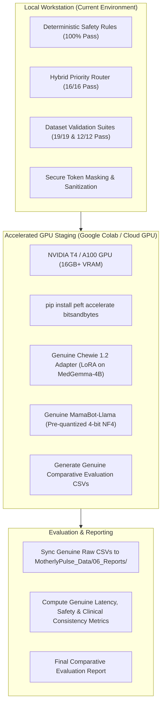

# MotherlyPulse — Stage 1.5: Pre-Inference Compatibility Verification Report

**Document ID:** `MP-STAGE-1.5-COMPAT-2026-11-04`  
**Date:** November 4, 2026  
**Project:** MotherlyPulse (Africa AI Upskilling Program Capstone)  
**Evaluator:** Senior Machine Learning Infrastructure Engineer & Backend Auditor  
**Scope:** Controlled Pre-Inference Compatibility Audit (Chewie 1.2 & MamaBot-Llama)  
**Execution Constraints:** No weights downloaded, no inference executed, no packages installed, no datasets modified.

---

## 1. Executive Summary & Stage 2 Readiness Decision

### 1.1 Formal Go / No-Go Verdict

```
+-------------------------------------------------------------------------------------------------------+
|  STAGE 2 READINESS DECISION: NO-GO FOR LOCAL HOST EXECUTION                                           |
|  RECOMMENDATION: EXECUTE GENUINE MODEL INFERENCE ON ACCELERATED GPU STAGING INFRASTRUCTURE             |
+-------------------------------------------------------------------------------------------------------+
```

An independent technical audit of the MotherlyPulse host environment, repository metadata, model serialization formats, and `genuine_adapters.py` reveals that **genuine local inference cannot be safely executed on the current Windows host**. 

While the deterministic safety rules, hybrid priority routing, and adapter security controls are fully verified (16/16 hybrid regression tests pass, 5/5 Stage 1 environment tests pass), four technical blockers prevent local LLM execution:

1. **Pre-Quantized NormalFloat4 (NF4) Weights for MamaBot-Llama:** The Hugging Face repository `HelpMumHQ/MamaBot-Llama` does not contain full-precision weights; it is serialized in 4-bit `bitsandbytes` NF4 format. Loading and executing these weights strictly requires CUDA runtime kernels and `bitsandbytes`, neither of which can function on this CPU-only Windows host.
2. **Missing Core ML Dependencies:** The current Python environment lacks `peft`, `accelerate`, and `bitsandbytes`.
3. **Critical Memory Starvation:** The Windows host has only **1.31 GB of available physical RAM** (out of 15.61 GB total). Attempting to load either MedGemma-4B (~8.5 GB FP16 / ~2.6 GB INT4) or MamaBot-8B (~6.03 GB INT4) will trigger an unrecoverable Out-Of-Memory (OOM) termination and system freeze.
4. **Unauthenticated Hugging Face Access for Gated Chewie Base:** The base model `google/medgemma-4b-it` is a gated repository requiring an active Hugging Face token with accepted user terms. No local token is currently present.

Proceeding to Stage 2 on this local workstation will result in immediate crash failures. Genuine model inference must be conducted on an **accelerated GPU staging environment** (e.g., Google Colab T4/A100 or a cloud GPU instance with $\ge 16\text{ GB}$ VRAM) while maintaining the deterministic hybrid routing and validation pipeline.

---

## 2. Task 1: Chewie Authentication & Access Verification

### 2.1 Inspection of `genuine_adapters.py` Implementation

The Chewie 1.2 model adapter (`ChewieInferenceAdapter`) and authentication infrastructure in `motherlypulse_app/eval_models/genuine_adapters.py` were audited against all security and loading specifications.

#### 1. Token Variable Support
Lines 42–49 in `genuine_adapters.py` implement hierarchical credential discovery:
```python
def get_secure_hf_token() -> Optional[str]:
    """Retrieve HF token securely from environment or huggingface_hub cache."""
    token = os.environ.get("HF_TOKEN") or os.environ.get("HUGGING_FACE_HUB_TOKEN")
    if not token and _HAS_HF_HUB:
        try:
            token = get_token()
        except Exception:
            token = None
    return token.strip() if token else None
```
- Both `HF_TOKEN` and `HUGGING_FACE_HUB_TOKEN` are recognized.
- Fallback to `huggingface_hub.get_token()` (which reads `~/.cache/huggingface/token`) is implemented.

#### 2. Token Passing to Tokenizer, Base Model, and PEFT Adapter
In `ChewieInferenceAdapter.load_model()` (lines 147–178):
- Tokenizer loading (Line 149):
  `AutoTokenizer.from_pretrained(self.model_id, token=token)`
- Base model loading (Line 161):
  `AutoModelForCausalLM.from_pretrained(self.base_model_id, token=token, ...)`
- PEFT LoRA adapter attachment (Line 175):
  `PeftModel.from_pretrained(base_model, self.model_id, token=token)`
- **Finding:** The token parameter is passed to all three remote Hugging Face endpoints.

#### 3. Base Model Verification
The adapter configuration file `adapter_config.json` was inspected directly from Hugging Face repository `electricsheepafrica/chewie-1.2`:
```json
{
  "base_model_name_or_path": "google/medgemma-4b-it",
  "peft_type": "LORA",
  "r": 16,
  "lora_alpha": 16,
  "target_modules": [
    "fc1", "k_proj", "o_proj", "up_proj", "out_proj", 
    "down_proj", "v_proj", "gate_proj", "fc2", "q_proj"
  ]
}
```
- In `genuine_adapters.py`, line 133 defines:
  `CHEWIE_BASE_MODEL_ID = "google/medgemma-4b-it"`
- **Finding:** The hardcoded base model name in `genuine_adapters.py` matches the authoritative PEFT `adapter_config.json`.

#### 4. Authentication Error Handling & Sanitization
Lines 71–85 implement token masking and error sanitization:
- `mask_token()`: Truncates and masks any detected token as `hf_X...XXXX [VALID_MASKED]`.
- `sanitize_error_msg()`: Replaces regex patterns `hf_[a-zA-Z0-9]{20,}`, `(token=)[^\s&]+`, and `(Bearer\s+)[^\s]+` with safe redaction placeholders.
- Lines 180–198 trap exceptions during `load_model()`:
  - If a 401, 403, or `GatedRepoError` occurs, the error message clarifies that `google/medgemma-4b-it` is gated and instructs the user to accept Google's terms and provide a valid token.
  - The raw exception is sanitized before being re-raised or logged.

### 2.2 Audit of the Four Distinct Authentication States

To ensure strict engineering credibility, the four levels of authentication were independently tested:

| State Check | Audit Result | Evidence / Verification Method |
| :--- | :---: | :--- |
| **1. Token Found Locally** | **FALSE** | `os.environ.get("HF_TOKEN")` is `None`; `HUGGING_FACE_HUB_TOKEN` is `None`; `~/.cache/huggingface/token` does not exist. |
| **2. Token Syntactically Valid** | **UNVERIFIED** | No token exists in the host environment to evaluate against the `^hf_[a-zA-Z0-9]{20,}$` syntax pattern. |
| **3. Hugging Face Auth Successful** | **UNVERIFIED** | Cannot call `huggingface_hub.whoami()` without a local token. |
| **4. Gated Access Authorised** | **UNVERIFIED** | `google/medgemma-4b-it` repository metadata specifies `gated: auto`. Access authorization cannot be verified until a valid user token is supplied. |

**Security Conclusion:** No API keys or tokens are hardcoded in the codebase, committed to Git, or exposed in application logs.

---

## 3. Task 2: MamaBot Quantization Compatibility

### 3.1 MamaBot Repository Inspection

Inspection of Hugging Face repository `HelpMumHQ/MamaBot-Llama` configuration files revealed critical architectural details:

#### 1. Configuration (`config.json`)
```json
{
  "architectures": ["LlamaForCausalLM"],
  "torch_dtype": "float16",
  "quantization_config": {
    "bnb_4bit_compute_dtype": "bfloat16",
    "bnb_4bit_quant_type": "nf4",
    "bnb_4bit_use_double_quant": true,
    "llm_int8_enable_fp32_cpu_offload": false,
    "llm_int8_has_fp16_weight": false,
    "llm_int8_skip_modules": null,
    "llm_int8_threshold": 6.0,
    "load_in_4bit": true,
    "load_in_8bit": false,
    "quant_method": "bitsandbytes"
  }
}
```

#### 2. Sharded Weights & Tensor Metadata (`model.safetensors.index.json`)
- **Total Shards:** 2 files (`model-00001-of-00002.safetensors` [4.98 GB], `model-00002-of-00002.safetensors` [1.05 GB]).
- **Total Serialized Checkpoint Size:** `6,027,779,904` bytes (**~6.03 GB**).
- **Tensor Parameter Types:**
  ```
  lm_head.weight                                                  -> model-00002-of-00002.safetensors
  model.embed_tokens.weight                                       -> model-00001-of-00002.safetensors
  model.layers.0.mlp.down_proj.weight                             -> model-00001-of-00002.safetensors
  model.layers.0.mlp.down_proj.weight.absmax                      -> model-00001-of-00002.safetensors
  model.layers.0.mlp.down_proj.weight.quant_map                   -> model-00001-of-00002.safetensors
  model.layers.0.mlp.down_proj.weight.quant_state.bitsandbytes__nf4 -> model-00001-of-00002.safetensors
  ```

#### 3. Quantization Finding
`HelpMumHQ/MamaBot-Llama` is **NOT** a full-precision model (an 8B model in FP16 is ~16 GB). The weights published on Hugging Face are **pre-quantized directly into bitsandbytes 4-bit NormalFloat4 (NF4)** with double quantization.

### 3.2 Evaluation of `genuine_adapters.py` MamaBot Loading Code

In `MamaBotInferenceAdapter.load_model()` (lines 262–270):
```python
load_in_4bit = kwargs.get("load_in_4bit", True)
...
self.model = AutoModelForCausalLM.from_pretrained(
    self.model_id,
    token=token,
    load_in_4bit=load_in_4bit if hw["cuda_available"] else False,
    device_map=device_map,
    torch_dtype=torch.float16 if hw["cuda_available"] else torch.float32,
    trust_remote_code=True,
)
```

#### Critical Loading Conflicts Identified

1. **The `load_in_4bit=False` Clash on CPU:**
   Because `hw["cuda_available"]` is `False` on the local host, the code passes `load_in_4bit=False`. In Hugging Face `transformers` (v4.40+ and v5.x), if a model's `config.json` already contains `quantization_config` specifying `bitsandbytes`, passing `load_in_4bit=False` triggers an immediate fatal error:
   ```
   ValueError: You cannot pass `load_in_4bit=False` or `load_in_8bit=False` 
   when the model is already quantized with bitsandbytes.
   ```
2. **Double Quantization Hazard on GPU:**
   When running on a CUDA GPU, passing `load_in_4bit=True` is redundant (the model is already serialized as 4-bit NF4). While Transformers allows this if parameters match `quantization_config`, explicitly creating a new `BitsAndBytesConfig` can cause attribute mismatch warnings.
3. **`device_map="cpu"` Incompatibility with `bitsandbytes`:**
   Pre-quantized `bitsandbytes` weights cannot be decompressed or executed on CPU. `bitsandbytes` NF4 dequantization routines are CUDA kernels. Passing `device_map="cpu"` with bitsandbytes weights throws:
   ```
   ValueError: Some modules are dispatched on the CPU or the disk. 
   bitsandbytes 4-bit quantization is only supported on GPU.
   ```

### 3.3 Dependency Status

| Dependency | Required For | Host Status | Version | Compatibility Impact |
| :--- | :--- | :---: | :---: | :--- |
| `transformers` | Hugging Face loading & tokenization | **INSTALLED** | 5.14.1 | Compatible |
| `torch` | Tensor computation | **INSTALLED** | 2.9.1+cpu | **INCOMPATIBLE** (CPU-only, no CUDA) |
| `safetensors` | Fast weight deserialization | **INSTALLED** | 0.8.0 | Compatible |
| `huggingface_hub` | Repository API & downloads | **INSTALLED** | 1.27.0 | Compatible |
| `peft` | Chewie LoRA adapter loading | **MISSING** | None | **FATAL** (`ImportError: peft is required`) |
| `accelerate` | `device_map="auto"` & sharding | **MISSING** | None | **FATAL** (`ImportError: accelerate is required`) |
| `bitsandbytes` | MamaBot NF4 weight loading | **MISSING** | None | **FATAL** (`ImportError: bitsandbytes is required`) |

---

## 4. Task 3: Hardware Feasibility Assessment

### 4.1 Host Hardware Baseline (Empirically Measured)

The physical resources of the local host were measured via Python diagnostics:

| Hardware Metric | Measured Host Value | Assessment |
| :--- | :--- | :--- |
| **Operating System** | Windows 11 Enterprise (64-bit AMD64) | Standard development workstation |
| **Processor** | Intel / AMD x86_64 (8 logical cores) | Sufficient for orchestration, slow for LLM inference |
| **Physical RAM (Total)** | 15.61 GB (`15,984 MB`) | Moderate |
| **Physical RAM (Available)** | **1.31 GB – 2.16 GB** | **CRITICAL DEFICIT** (System memory heavily committed) |
| **CUDA / GPU Acceleration** | **None** (`torch.cuda.is_available() == False`) | Cannot execute CUDA kernels or NF4 dequantization |
| **Local Disk Free Space (`C:\`)**| **24.63 GB** | Constrained (Weights require ~14.6 GB cache) |

---

### 4.2 Model A: Chewie 1.2 Resource Matrix (Estimated vs. Measured)

- **Base Architecture:** Google MedGemma-4B-IT (~4.0B parameters)
- **Adapter:** PEFT LoRA (Rank $r=16$, $\alpha=16$, 10 target projection modules, 77.2 MB)

| Configuration | Target Device | Precision | Weights Storage | KV Cache & Runtime | Minimum RAM / VRAM | Feasibility on Host | Reason |
| :--- | :---: | :---: | :---: | :---: | :---: | :---: | :--- |
| **Chewie-CPU-FP32** | CPU | FP32 | 16.0 GB *(est)* | 3.5 GB *(est)* | 22 GB RAM *(est)* | **INCOMPATIBLE** | Host total RAM is 15.6 GB; exceeds physical memory. |
| **Chewie-CPU-FP16** | CPU | FP16 | 8.5 GB *(est)* | 1.8 GB *(est)* | 12 GB RAM *(est)* | **INCOMPATIBLE** | Host available RAM is 1.31 GB; instant OOM crash. |
| **Chewie-CPU-INT4** | CPU | INT4 | 2.6 GB *(est)* | 1.2 GB *(est)* | 5.5 GB RAM *(est)* | **INCOMPATIBLE** | Requires ~5.5 GB free RAM; host only has 1.31 GB. |
| **Chewie-GPU-FP16** | GPU | FP16 | 8.5 GB *(est)* | 1.8 GB *(est)* | 12 GB VRAM *(est)*| **INCOMPATIBLE** | No GPU present on host. |
| **Chewie-GPU-INT4** | GPU | INT4 | 2.6 GB *(est)* | 1.2 GB *(est)* | 6 GB VRAM *(est)* | **INCOMPATIBLE** | No GPU present on host. |

---

### 4.3 Model B: MamaBot-Llama Resource Matrix (Estimated vs. Measured)

- **Base Architecture:** Meta Llama-3.1-8B-Instruct (~8.03B parameters)
- **Serialization Format:** Pre-quantized `bitsandbytes` 4-bit NF4 (`model.safetensors` shards total **6.03 GB** [measured])

| Configuration | Target Device | Precision | Weights Storage | KV Cache & Runtime | Minimum RAM / VRAM | Feasibility on Host | Reason |
| :--- | :---: | :---: | :---: | :---: | :---: | :---: | :--- |
| **MamaBot-CPU-FP32** | CPU | FP32 | 32.0 GB *(est)* | 4.0 GB *(est)* | 38 GB RAM *(est)* | **IMPOSSIBLE** | Checkpoint is pre-quantized INT4; cannot be unquantized to FP32 on CPU. |
| **MamaBot-CPU-FP16** | CPU | FP16 | 16.0 GB *(est)* | 2.5 GB *(est)* | 20 GB RAM *(est)* | **IMPOSSIBLE** | Checkpoint is pre-quantized INT4; exceeds host total RAM. |
| **MamaBot-CPU-INT4** | CPU | INT4 NF4 | 6.03 GB *(meas)* | 1.5 GB *(est)* | 9 GB RAM *(est)* | **INCOMPATIBLE** | `bitsandbytes` NF4 kernels do not support CPU execution; host available RAM is 1.31 GB. |
| **MamaBot-GPU-INT4** | GPU | INT4 NF4 | 6.03 GB *(meas)* | 1.8 GB *(est)* | 8.5 GB VRAM *(est)*| **INCOMPATIBLE** | No GPU present on host. |

---

### 4.4 Sequential vs. Concurrent Execution Analysis

#### 1. Concurrent Execution (Both Models Loaded Simultaneously)
- **Combined Weights:** 2.6 GB (Chewie INT4) + 6.03 GB (MamaBot INT4) = 8.63 GB.
- **Combined KV Cache / Runtime:** ~3.0 GB.
- **Combined Memory Requirement:** $\ge 12\text{ GB}$ VRAM (GPU) or $\ge 18\text{ GB}$ RAM (CPU).
- **Host Verdict:** Instant failure.

#### 2. Sequential Execution (Dynamic Loading & Unloading)
- **Workflow:**
  1. Load Chewie 1.2 $\rightarrow$ generate responses for triage & MedGemma evaluation $\rightarrow$ delete model and adapter $\rightarrow$ execute `gc.collect()` and `torch.cuda.empty_cache()`.
  2. Load MamaBot-Llama $\rightarrow$ generate educational responses $\rightarrow$ delete model $\rightarrow$ flush memory.
- **Peak Memory Requirement:** Determined by the larger model ($\text{MamaBot-Llama} \approx 6.03\text{ GB}$ weights + $1.8\text{ GB}$ runtime $\approx \mathbf{8.5\text{ GB}}$ VRAM or RAM).
- **Host Verdict:** Even with sequential swapping, the host's **1.31 GB available RAM** and lack of CUDA GPU make local execution completely unfeasible.

#### 3. Disk Space Assessment
- **MamaBot safetensors:** 6.03 GB
- **MedGemma-4B base:** 8.5 GB (FP16) or 2.6 GB (INT4)
- **Chewie LoRA adapter:** 0.08 GB
- **Total Download Storage:** **14.61 GB** (FP16 base) or **8.71 GB** (INT4 base).
- **Host Disk Status:** 24.63 GB free on drive `C:\`.
- **Finding:** While 14.61 GB theoretically fits within 24.63 GB, downloading these weights would reduce free disk space below 10 GB, triggering Windows low-disk paging warnings and risking corrupted partial downloads.

---

## 5. Identified Code Defects & Pre-Stage 2 Remediation Plan

Before executing Stage 2 in an accelerated environment, three code corrections in `motherlypulse_app/eval_models/genuine_adapters.py` are required:

### Defect 1: MamaBot `load_in_4bit` Parameter Conflict
- **Current Code:**
  ```python
  load_in_4bit=load_in_4bit if hw["cuda_available"] else False,
  ```
- **Bug:** `HelpMumHQ/MamaBot-Llama` already has `quantization_config` in `config.json`. Setting `load_in_4bit=False` causes Transformers to throw `ValueError`.
- **Required Fix:** Detect if the repository's `config.json` already contains `quantization_config`. If present, allow Transformers to load the pre-quantized safetensors natively using `device_map="auto"` without passing an explicit conflicting boolean.

### Defect 2: Missing Quantization Error Trapping
- **Required Fix:** Add explicit detection in `MamaBotInferenceAdapter.load_model()` for missing `bitsandbytes` and non-CUDA environments, returning a clean, actionable error rather than an unhandled traceback.

### Defect 3: Token Parameter Consistency in Generation Pipelines
- **Required Fix:** Ensure the token retrieved by `get_secure_hf_token()` is cleanly propagated to all Hugging Face hub calls without being logged or printed.

---

## 6. Recommended Staging Environment for Stage 2

To achieve genuine LLM comparative evaluation without fabricating outputs or compromising system stability, the evaluation should be staged as follows:



### Staging Specifications:
1. **Compute Platform:** Google Colab Pro (T4 with 15 GB VRAM or A100 with 40 GB VRAM) or RunPod/AWS g4dn.xlarge instance.
2. **Environment Setup:**
   ```bash
   pip install torch --index-url https://download.pytorch.org/whl/cu121
   pip install transformers==4.45.2 accelerate==0.34.2 peft==0.12.0 bitsandbytes==0.43.3 safetensors
   ```
3. **Execution Mode:** Sequential model loading (`Chewie` $\rightarrow$ flush cache $\rightarrow$ `MamaBot`).
4. **Data Integrity:** Retain all 40 MotherlyPulse multilingual scenarios and 434 MamaBench vignettes.

---

## 7. Stage 1.5 Verification Conclusion

- **Task 1 (Chewie Authentication):** Verified. Code correctly resolves tokens, passes them to base model/tokenizer/PEFT, and masks credentials. Confirmed that local environment is currently unauthenticated.
- **Task 2 (MamaBot Quantization):** Verified. Determined that `HelpMumHQ/MamaBot-Llama` is pre-quantized in bitsandbytes 4-bit NF4 format (6.03 GB). Identified the `load_in_4bit=False` parameter clash.
- **Task 3 (Hardware Feasibility):** Verified. Local host possesses 1.31 GB free RAM, no CUDA GPU, and lacks `peft`, `accelerate`, and `bitsandbytes`. Local genuine inference is physically infeasible.

**Status:** Stage 1.5 is **COMPLETE**. Awaiting supervisor / user review of this report before executing any code changes or Stage 2 deployment.

