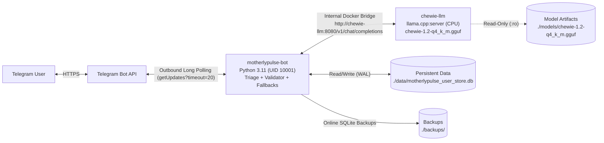

# MotherlyPulse VPS Deployment and Hosting

This document describes the production Linux VPS deployment and operational management of **MotherlyPulse** (`@MotherlyPulse_bot`). MotherlyPulse runs in a shared personal Linux VPS environment, isolated within its own project directory, Docker Compose stack, and internal bridge network.

---

## 1. Deployment Overview

MotherlyPulse is deployed 24/7 using **Docker** and **Docker Compose** (`motherlypulse` Compose project) split into two isolated containers:

1. **`motherlypulse-bot`**: Lightweight Python 3.11 application container running Telegram long polling, `DynamicTriageClassifier` (`112` emergency preemption), `ClinicalInvariantValidator`, `DeterministicReference` fallbacks, Ondo State PHC/immunization lookup, and SQLite persistence.
2. **`chewie-llm`**: Dedicated CPU-based `llama.cpp` server (`ghcr.io/ggml-org/llama.cpp:server`) serving the quantized `chewie-1.2-q4_k_m.gguf` model over an internal Docker bridge network with zero public host ports.

All clinical safety gates and deterministic fallbacks execute locally inside `motherlypulse-bot`.

---

## 2. Hosting Architecture



### Architectural Characteristics
- **Outbound-Only Public Communication:** `motherlypulse-bot` uses outbound HTTPS long polling, requiring no inbound HTTP/HTTPS ports or public webhook endpoints.
- **Internal-Only AI Inference:** `chewie-llm` attaches solely to an internal Docker bridge network and exposes port `8080` only to `motherlypulse-bot`.
- **Graceful Degradation:** If `chewie-llm` is stopped, unreachable, or exceeds `AI_MODEL_TIMEOUT` (`45.0s`), `AIModelConnector` catches the error and falls back to `DeterministicReference`. `DynamicTriageClassifier` (`112` escalation) always runs locally before any AI call.

---

## 3. Application Deployment Structure

The project deployment directory on the VPS (`/opt/apps/motherlypulse/`) is structured as follows:

```text
/opt/apps/motherlypulse/
├── .dockerignore               # Excludes .env, *.db, data/, backups/, .git/ from builds
├── .env                        # Mode 0600 (root:root) — runtime tokens & AI configuration
├── .env.example                # Non-secret environment template
├── Dockerfile                  # python:3.11-slim-bookworm, UID/GID 10001:10001
├── docker-compose.yml          # Compose project: motherlypulse
├── healthcheck.py              # Container healthcheck (SQLite read + Telegram getMe)
├── requirements.txt            # numpy, scipy, scikit-learn, pandas
├── run_telegram_bot.py         # Telegram bot entrypoint
├── motherlypulse_app/          # Application Python package
├── MotherlyPulse_Data/         # Clinical passages, emergency rules, Ondo PHC & immunization data
├── deployment/                 # Legacy templates & Colab export notebooks
├── models/                     # Read-only model mount for chewie-llm
│   ├── chewie-1.2-q4_k_m.gguf
│   └── chewie-1.2-q4_k_m.gguf.sha256
├── data/                       # (0750, 10001:10001) Mounted at /var/lib/motherlypulse
│   └── motherlypulse_user_store.db
└── backups/                    # (0750, 10001:10001) Mounted at /var/backups/motherlypulse
```

---

## 4. Docker and Containerisation

| Service / Container | Image | Runtime & Command | Resource Limits | Networks |
| :--- | :--- | :--- | :--- | :--- |
| **`motherlypulse-bot`** | `motherlypulse-bot:latest` (`python:3.11-slim-bookworm`) | `python -u /app/run_telegram_bot.py` | `1.0` CPU, `512 MiB` RAM (`memswap_limit: 512m`) | Default bridge (outbound HTTPS) + internal AI bridge |
| **`chewie-llm`** | `ghcr.io/ggml-org/llama.cpp:server` | `--model /models/chewie-1.2-q4_k_m.gguf --alias chewie-1.2 --host 0.0.0.0 --port 8080 --ctx-size 2048 --threads 3 --n-gpu-layers 0` | `3.0` CPUs, `2560 MiB` RAM (`memswap_limit: 2560m`) | Internal AI bridge only |

---

## 5. Application Startup and Process Management

- **Container Supervision:** Both services are managed by Docker Compose with `restart: unless-stopped`.
- **No Host `systemd` Unit:** `deployment/motherlypulse.service` in the repository is a legacy bare-metal template and is **not** used in the active Docker Compose deployment.
- **Health Checks:** `motherlypulse-bot` runs `python /app/healthcheck.py` every `60s` to verify SQLite read access and Telegram `getMe` API connectivity.
- **Operational Commands (from `/opt/apps/motherlypulse/`):**
  - Status: `docker compose -p motherlypulse ps`
  - Logs: `docker compose -p motherlypulse logs -f --tail=50`
  - Restart: `docker compose -p motherlypulse restart`
  - Stop / Start: `docker compose -p motherlypulse stop` / `docker compose -p motherlypulse start`

---

## 6. Service Restart and Recovery

- Docker Compose's `restart: unless-stopped` policy automatically restarts containers on unexpected process exit or Docker daemon startup.
- If `chewie-llm` is unavailable during startup or maintenance, `motherlypulse-bot` continues serving Telegram users via `DeterministicReference` fallbacks and `DynamicTriageClassifier` (`112`).

---

## 7. Environment Configuration

Runtime configuration is supplied via `/opt/apps/motherlypulse/.env` (`0600 root:root`, excluded from Git and Docker image builds). Template defaults are documented in [`.env.example`](../.env.example):

| Variable | Purpose | Production `chewie-llm` Setting / Safe Default |
| :--- | :--- | :--- |
| `TELEGRAM_BOT_TOKEN` | Bot token for Telegram long polling | Set privately in `.env` (never committed) |
| `MOTHERLYPULSE_DB_PATH` | SQLite database path inside container | `/var/lib/motherlypulse/motherlypulse_user_store.db` |
| `AI_MODEL_BACKEND` | Inference backend mode | `remote` on VPS (`disabled` in `.env.example` safe default) |
| `AI_MODEL_NAME` | Logical model identifier | `chewie-1.2` |
| `AI_MODEL_ENDPOINT` | Internal `llama-server` chat completions URL | `http://chewie-llm:8080/v1/chat/completions` |
| `AI_MODEL_API_FORMAT` | Payload format (`auto`, `openai`, `custom`) | `auto` (detects `/v1/chat/completions` as OpenAI) |
| `AI_MODEL_TIMEOUT` | Outbound HTTP timeout in seconds | `45.0` |

---

## 8. Data Persistence

- **SQLite 3 (WAL Mode):** User profiles, consent records, language preferences, and reminders are stored at `/opt/apps/motherlypulse/data/motherlypulse_user_store.db` (mounted at `/var/lib/motherlypulse/motherlypulse_user_store.db`).
- **Permissions:** Host directories `data/` and `backups/` are owned by `10001:10001` (`0750`) so the non-root container user can create and maintain SQLite `-wal` and `-shm` files. Never run `docker compose down -v` or delete `data/`.

---

## 9. Backup Arrangements

- **Daily Online WAL-Safe Backups:** A project-scoped backup job performs daily online WAL-safe SQLite backups of `motherlypulse_user_store.db`, executes `PRAGMA integrity_check;`, logs user counts, and archives MotherlyPulse configuration to `./backups/`.
- **Pre-Deployment Backups:** A backup of `/opt/apps/motherlypulse/` is taken before applying updates.
- **Application Helper:** `motherlypulse_app.user_store.backup_database()` writes online backups to `/var/backups/motherlypulse`.
- **Legacy Script Note:** `deployment/backup_db.sh` is a legacy bare-metal template and is not used in the Docker deployment.

---

## 10. Application Updates and Maintenance

Updates are deployed without disturbing persistent data or secrets:
1. Run a pre-deployment backup of `/opt/apps/motherlypulse/`.
2. Package a clean `tar.gz` archive of the target Git commit via `git archive` (omitting `.git`, `.env`, `data/`, `backups/`) and extract into `/opt/apps/motherlypulse/`.
3. Preserve `.env` (`0600`), `data/` (`10001:10001`), `backups/` (`10001:10001`), and `models/`.
4. Rebuild and recreate containers: `docker compose -p motherlypulse up -d --build`.

---

## 11. Deployment Verification

Verified on deployed commit `a2be3a35a3176175f0c650ba53d03c4cfc843d6e`:
- **Container Health & Resource Usage:**
  - `motherlypulse-bot`: `Up` / `healthy` (`17.84 MiB / 512 MiB` RAM, `3.48%`); `healthcheck.py` returned `OK`.
  - `chewie-llm`: `Up` / `healthy` (`1.178 GiB / 2.5 GiB` RAM, `47.14%`); `http://chewie-llm:8080/health` returned `{"status":"ok"}`.
- **Telegram Long Polling:** Container logs confirmed active polling as `@MotherlyPulse_bot` with no HTTP `401`, `404`, or `409` errors.
- **End-to-End AI + Clinical Validator Check:** Running `AIModelConnector().generate_response('I have mild nausea in the morning', 'routine', 'English', 'ROUTINE: Fallback')` inside `motherlypulse-bot` returned `ai_generated: True`, `safety_validated: True`, `fallback_triggered: False`, `model_used: 'chewie-1.2'`, `latency_ms: 8911.58`.
- **Database Integrity:** `PRAGMA integrity_check;` on `/var/lib/motherlypulse/motherlypulse_user_store.db` returned `('ok',)` (`users_count: 2`).

---

## 12. Security Considerations

- **Secrets Isolation:** Tokens and runtime configuration reside exclusively in `.env` (`0600 root:root`), excluded by `.dockerignore` and `.gitignore`.
- **Least Privilege:** `motherlypulse-bot` runs as non-root `10001:10001`; both containers enforce `no-new-privileges:true` and `cap_drop: [ALL]`.
- **Model Integrity:** `./models/` is mounted read-only (`:ro`) into `chewie-llm`, and `chewie-1.2-q4_k_m.gguf` was verified against its SHA-256 checksum (`a372747bbf1852a63d738a270b19c8d215ccc4c30215a99a865bba8dda58e579`).
- **Zero Inbound Ports & Log Rotation:** Neither container exposes inbound host ports; `json-file` logs are capped (`max-size: 10m`, `max-file: 3`).
- **Single-Poller Constraint:** Only one instance of `motherlypulse-bot` may poll Telegram with the production token at a time; a second poller triggers Telegram `HTTP 409 Conflict`.

---

## 13. Known Limitations

- **`/compare` on VPS-Only Stack:** `chewie-llm` loads only the fine-tuned `chewie-1.2-q4_k_m.gguf` model; `/compare` requires a dual base+adapter endpoint (such as a Colab GPU demo server) and returns an unavailable notice in `chewie-llm`-only mode.
- **CPU Inference Latency:** Responses from `chewie-llm` on CPU take ~8–12s, requiring `AI_MODEL_TIMEOUT=45.0`.
- **Host Reboot Recovery:** `restart: unless-stopped` is configured, though a forced host reboot test was not separately executed after `a2be3a3`.
- **Manual Restore Drills:** Automated end-to-end database restore into a fresh container is not automated in the repository and remains a manual operational procedure.
- **Legacy Deployment Templates:** `deployment/motherlypulse.service`, `deployment/setup_server.sh`, `deployment/deploy.sh`, and `deployment/backup_db.sh` reflect pre-Docker host assumptions rather than the active Docker Compose stack.
- **No In-Place `git pull` on VPS:** `/opt/apps/motherlypulse/` is updated via `tar.gz` archives and does not contain `.git`.
