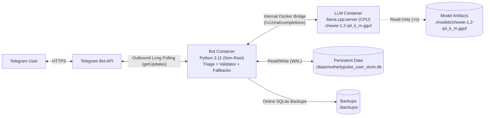

# MotherlyPulse VPS Deployment and Hosting

This document describes the containerized Linux VPS deployment and operational architecture of **MotherlyPulse** (`@MotherlyPulse_bot`). MotherlyPulse runs in a shared personal Linux VPS environment, isolated within its own project directory, Docker Compose stack, and internal bridge network.

---

## 1. Deployment Overview

MotherlyPulse is deployed using **Docker** and **Docker Compose** as two isolated containers:

1. **Bot Service (`bot` / Telegram application container):** Lightweight Python 3.11 container running outbound Telegram long polling, `DynamicTriageClassifier` (`112` emergency preemption), `ClinicalInvariantValidator`, `DeterministicReference` fallbacks, Ondo State PHC/immunization lookup, and SQLite persistence.
2. **LLM Inference Service (`llm` / `llama.cpp` server container):** Dedicated CPU-based `ghcr.io/ggml-org/llama.cpp:server` container serving the quantized `chewie-1.2-q4_k_m.gguf` model over an internal Docker bridge network with zero public host ports.

All clinical safety gates and deterministic fallbacks execute locally inside the bot container.

---

## 2. Hosting Architecture

### Architectural Characteristics
- **Outbound-Only Public Communication:** The bot container uses outbound HTTPS long polling, requiring no inbound HTTP/HTTPS ports or public webhook endpoints.
- **Internal-Only AI Inference:** The LLM container attaches solely to an internal Docker bridge network and exposes its inference port only to the bot container.
- **Graceful Degradation:** If the LLM container is stopped, unreachable, or exceeds `AI_MODEL_TIMEOUT`, `AIModelConnector` catches the failure and automatically falls back to `DeterministicReference`. `DynamicTriageClassifier` (`112` escalation) always runs locally before any AI call.

---

## 3. Public Templates vs. Live VPS Deployment

This repository includes sanitized, public-safe container templates at the repository root:
- [`Dockerfile`](../Dockerfile): Non-root (`10001:10001`) `python:3.11-slim-bookworm` image running `run_telegram_bot.py`.
- [`.dockerignore`](../.dockerignore): Excludes `.env`, local databases, model binaries, and `.git` from image builds.
- [`docker-compose.example.yml`](../docker-compose.example.yml): Example two-container Compose topology with `env_file: .env`, `./data`, `./backups`, `./models:ro`, internal bridge isolation, `no-new-privileges:true`, and `cap_drop: [ALL]`.

**Relationship to Production:** These files are sanitized templates that mirror the production architecture without exposing private host paths, credentials, or production `.env` values. The live VPS deployment runs from a dedicated host directory with its own private `.env` (`0600` permissions) and host-specific volume mounts.

---

## 4. Container & Resource Isolation

- **Bot Container:** Built from `python:3.11-slim-bookworm`, running as non-root UID/GID `10001:10001`, memory-bounded (`512m` limit in the template), attached to the default outbound network (for Telegram API HTTPS) and the internal AI bridge.
- **LLM Container:** Uses `ghcr.io/ggml-org/llama.cpp:server` (`--n-gpu-layers 0`, `--ctx-size 2048`), memory-bounded (`2560m` limit in the template), attached exclusively to the internal AI bridge (`internal: true`).
- **Kernel Hardening:** Both containers enforce `no-new-privileges:true`, `cap_drop: [ALL]`, and bounded `json-file` log rotation.

---

## 5. Startup, Supervision & Health Checks

- **Container Supervision:** Both services run with `restart: unless-stopped` under Docker Compose.
- **No Host `systemd` Unit:** `deployment/motherlypulse.service` in `deployment/` is a legacy bare-metal template and is **not** used in the Docker Compose deployment.
- **Health Checks:** The bot container runs a periodic health check (verifying SQLite read access and Telegram `getMe` connectivity), and the LLM container exposes an internal `/health` check on the private bridge.

---

## 6. AI Configuration: Default vs. Deployed Status

MotherlyPulse distinguishes four separate concepts:

1. **Default / Template Configuration (`.env.example` & `AIModelConnector`):** Both `.env.example` and `AIModelConnector.__init__` default to `AI_MODEL_BACKEND=disabled` (deterministic-only mode) so local setups and unconfigured deployments operate safely without a running LLM server.
2. **VPS Deployment Configuration:** On the deployed VPS, a private `.env` (never committed to Git) overrides `AI_MODEL_BACKEND` to `remote`, pointing `AI_MODEL_ENDPOINT` to the internal `llama.cpp` container over Docker's private bridge (`AI_MODEL_API_FORMAT=auto`).
3. **Offline Model Evaluation (`n = 135`):** Benchmark metrics (`120` held-out test prompts + `15` `fixed_15` prompts) measure offline model behavior in a controlled evaluation harness. **They do not represent live production usage volume or formal clinical validation.**
4. **Live VPS Inference Capability:** Container healthchecks and an internal smoke test (`AIModelConnector().generate_response(...)`) verified that the bot container can reach the `llama.cpp` container and validate responses through `ClinicalInvariantValidator`.

| Variable (`.env.example`) | Purpose | Default in `.env.example` |
| :--- | :--- | :--- |
| `TELEGRAM_BOT_TOKEN` | Bot token for Telegram long polling | Placeholder (`your_telegram_bot_token_here`) |
| `MOTHERLYPULSE_DB_PATH` | SQLite database path inside container | `/app/data/motherlypulse.db` (or `/var/lib/motherlypulse/...` in Docker) |
| `AI_MODEL_BACKEND` | Inference backend (`disabled`, `remote`, `local`, `mock`) | `disabled` |
| `AI_MODEL_NAME` | Logical model identifier | `chewie-1.2` |
| `AI_MODEL_ENDPOINT` | Remote OpenAI-compatible or custom endpoint URL | Template placeholder (`http://chewie-llm:8080/v1/chat/completions`) |
| `AI_MODEL_API_FORMAT` | Payload format (`auto`, `openai`, `custom`) | `auto` |
| `AI_MODEL_TIMEOUT` | Outbound HTTP timeout in seconds | `45.0` |

---

## 7. Data Persistence & Backup Arrangements

- **SQLite 3 (WAL Mode):** User profiles, consent records, language preferences, and reminders are stored in a persistent SQLite 3 database (`./data/motherlypulse_user_store.db`).
- **Permissions:** Host `data/` and `backups/` directories are owned by `10001:10001` (`0750`) so the non-root container user can create and maintain SQLite `-wal` and `-shm` files. Never run `docker compose down -v` or delete `data/`.
- **Backups:** Daily online WAL-safe SQLite backups with `PRAGMA integrity_check;` and pre-deployment backups write to `./backups/`. Application-level online backup is also available via `motherlypulse_app.user_store.backup_database()`.
- **Legacy Script Note:** `deployment/backup_db.sh` is a legacy bare-metal template and is not used in the Docker deployment.

---

## 8. Application Updates & Verification

- **Updates:** Deployed via clean `git archive` `tar.gz` packages (omitting `.git`, `.env`, `data/`, `backups/`) while preserving `.env`, `data/`, `backups/`, and `models/`, then rebuilding with `docker compose up -d --build`.
- **Verification Summary:** Deployment checks on the `a2be3a3` release confirmed healthy bot and LLM containers, active outbound Telegram long polling (`@MotherlyPulse_bot`), SQLite `PRAGMA integrity_check` passing, and end-to-end `AIModelConnector` + `ClinicalInvariantValidator` execution against the internal `chewie-1.2` GGUF service.

---

## 9. Security Considerations & Known Limitations

- **Secrets & Integrity:** Production `.env` (`0600`) is excluded from Git and Docker images; the GGUF model mount is read-only (`:ro`) and verified by SHA-256 checksum; neither container exposes inbound host ports; only one bot instance may poll Telegram with a given token (a second poller causes `HTTP 409 Conflict`).
- **`/compare` on VPS-Only Stack:** The VPS LLM container loads only fine-tuned `chewie-1.2-q4_k_m.gguf`; `/compare` requires a dual base+adapter endpoint (such as a GPU demo server).
- **CPU Inference Latency:** CPU-based `llama.cpp` inference takes several seconds per reply, requiring a generous `AI_MODEL_TIMEOUT` (`45.0s`).
- **Operational Gaps:** Forced host-reboot recovery was not independently tested after `a2be3a3`, and automated database restore into a fresh container remains a manual operational procedure.
- **Legacy Templates:** `deployment/motherlypulse.service`, `deployment/setup_server.sh`, `deployment/deploy.sh`, and `deployment/backup_db.sh` reflect pre-Docker host assumptions.
